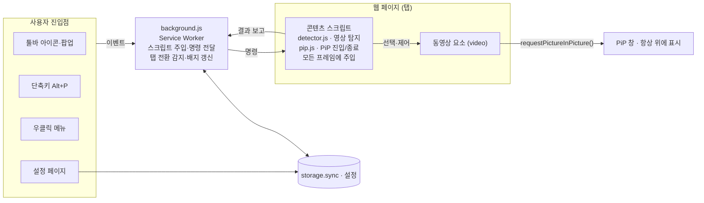
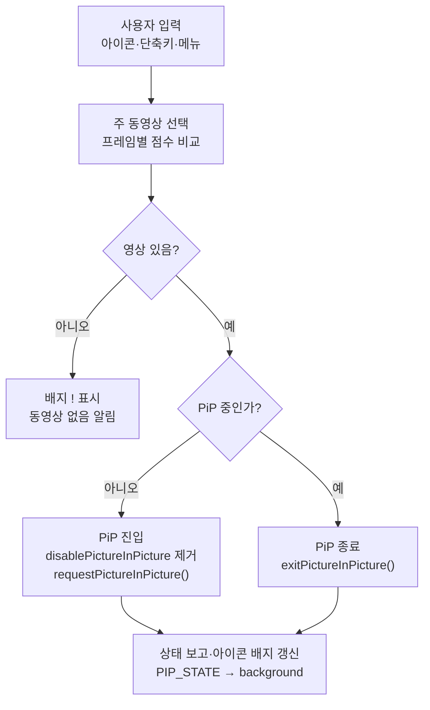

# Edge 동영상 PiP 프로그램 설계서

작성일: 2026-11-11

## 1. 개요

Microsoft Edge에서 재생 중인 웹 동영상을 클릭 한 번 또는 단축키로 PiP(Picture-in-Picture) 창에 띄우는 Edge 확장 프로그램을 만든다. 사이트가 자체 PiP 버튼을 제공하지 않아도 동작하는 것이 핵심이다.

**범위**

- 포함: 일반 HTML5 `<video>` 요소의 PiP 전환, 탭 전환 시 자동 PiP, 단축키·팝업·우클릭 메뉴, 사용자 설정
- 제외: DRM 보호 영상의 화면 캡처 우회, Edge 이외 브라우저(Chrome은 같은 코드로 호환되나 공식 지원 대상 아님), 모바일 Edge

**용어**

| 용어 | 의미 |
| --- | --- |
| PiP | 동영상을 다른 창 위에 항상 떠 있는 작은 창으로 재생하는 브라우저 기능 |
| MV3 | Manifest V3, 현재 Edge 확장 프로그램 규격 |
| Service Worker | 확장 프로그램의 백그라운드 로직을 담당하는 이벤트 기반 스크립트 |
| Content Script | 웹페이지 안에 주입되어 DOM에 접근하는 스크립트 |
| Document PiP | 동영상뿐 아니라 임의의 HTML을 PiP 창에 띄우는 API (`documentPictureInPicture`) |

## 2. 요구사항

필수(P1) 기능만으로 1차 출시가 가능하며, P2는 후속 버전에서 추가한다.

**기능 요구사항**

| ID | 요구사항 | 우선순위 |
| --- | --- | --- |
| F-01 | 툴바 아이콘 클릭 시 현재 탭의 주 동영상을 PiP로 전환, 다시 클릭 시 종료 | P1 |
| F-02 | 단축키(기본 Alt+P)로 PiP 토글 | P1 |
| F-03 | 페이지에 동영상이 여러 개일 때 재생 중·크기·화면 노출 기준으로 주 동영상 자동 선택 | P1 |
| F-04 | iframe 내부 동영상(예: 임베드 영상) 지원 | P1 |
| F-05 | `disablePictureInPicture` 속성이 있는 영상도 강제 전환 | P1 |
| F-06 | 우클릭 컨텍스트 메뉴 "PiP로 보기" | P2 |
| F-07 | 다른 탭으로 전환하면 자동 PiP, 돌아오면 자동 종료(옵션) | P2 |
| F-08 | PiP 창에서 재생/일시정지, 이전/다음 트랙(Media Session API) | P2 |
| F-09 | 사이트별 허용/차단 목록 설정 | P2 |

**비기능 요구사항**

| ID | 항목 | 기준 |
| --- | --- | --- |
| N-01 | 반응성 | 클릭·단축키 후 PiP 창 표시까지 300ms 이내 |
| N-02 | 성능 | 페이지 로드 시간 증가 10ms 미만, 상시 폴링 없음 |
| N-03 | 호환성 | Edge 120 이상, Windows 10/11 · macOS |
| N-04 | 개인정보 | 방문 기록·영상 정보를 외부로 전송하지 않음 |
| N-05 | 다국어 | 한국어·영어 UI (`_locales`) |

## 3. 구현 방식 비교 및 선정

**결론: Edge 확장 프로그램(Manifest V3)으로 구현한다.** 브라우저 내장 PiP API를 그대로 쓰므로 화질 손실과 추가 권한이 없고, Edge Add-ons 스토어로 바로 배포할 수 있다.

| 방식 | 장점 | 단점 | 판단 |
| --- | --- | --- | --- |
| A. Edge 확장 프로그램 (MV3) | 표준 `requestPictureInPicture()` 사용, 원본 화질, 설치·업데이트 간편, Chrome과 코드 호환 | 브라우저 밖 제어 불가, 사용자 제스처 필요 | **선정** |
| B. 데스크톱 앱 (C#/WPF + 화면 캡처) | 모든 창 대상 가능 | 화질·CPU 부담 큼, DRM 영상은 검은 화면, 오디오 분리 불가 | 제외 |
| C. 데스크톱 앱 + 키 자동화 (단축키 주입) | 구현 단순 | Edge 내장 PiP 단축키가 없어 신뢰성 낮음, 포커스 문제 | 제외 |

데스크톱 전용 기능(예: 트레이 아이콘, 전역 단축키)이 필요해지면 확장 프로그램의 전역 단축키(`commands`의 `global: true`)로 먼저 대응한다.

## 4. 시스템 아키텍처

모든 사용자 입력은 background.js로 모이고, background가 해당 탭의 콘텐츠 스크립트에 명령을 보내 동영상을 PiP 창으로 띄운다.



페이지 DOM에 직접 접근하는 것은 콘텐츠 스크립트뿐이며, 팝업·설정 페이지는 background와 storage를 통해서만 동작한다.

## 5. 주요 동작 흐름

아이콘·단축키·메뉴는 모두 하나의 토글 흐름을 타며, 현재 PiP 상태에 따라 진입 또는 종료로 갈린다.



자동 PiP(F-07)는 별도 경로다. 재생 중인 페이지에서 Media Session의 `enterpictureinpicture` 액션을 미리 등록해 두면, 탭을 벗어날 때 Edge가 PiP를 열고 돌아오면 background가 `tabs.onActivated`에서 종료 명령을 보낸다.

## 6. 모듈 상세 설계

확장 프로그램은 5개 파일 그룹으로 구성되며, 모든 모듈은 `chrome.runtime` 메시지로만 통신한다.

**폴더 구조**

```
edge-pip/
├─ manifest.json
├─ background.js        # Service Worker
├─ content/
│  ├─ detector.js       # 동영상 탐지·선택
│  └─ pip.js            # PiP 진입/종료
├─ popup/  (popup.html, popup.js, popup.css)
├─ options/ (options.html, options.js)
├─ _locales/ (ko, en)
└─ icons/ (16, 32, 48, 128 px)
```

**manifest.json 핵심 항목**

```json
{
  "manifest_version": 3,
  "name": "__MSG_appName__",
  "version": "1.0.0",
  "default_locale": "ko",
  "permissions": ["activeTab", "scripting", "storage", "contextMenus"],
  "host_permissions": ["<all_urls>"],
  "background": { "service_worker": "background.js" },
  "action": { "default_popup": "popup/popup.html" },
  "commands": {
    "toggle-pip": {
      "suggested_key": { "default": "Alt+P" },
      "description": "__MSG_cmdToggle__"
    }
  },
  "options_page": "options/options.html"
}
```

**모듈별 책임**

| 모듈 | 책임 | 주요 API |
| --- | --- | --- |
| background.js | 단축키·아이콘·메뉴 이벤트 수신, 콘텐츠 스크립트 주입, 탭 전환 감지, 아이콘 배지 갱신 | `commands`, `scripting.executeScript({allFrames:true})`, `tabs.onActivated`, `action.setBadgeText` |
| detector.js | 모든 프레임에서 `<video>` 수집(Shadow DOM 포함), 점수 계산 후 후보 반환 | `querySelectorAll`, `IntersectionObserver`, `MutationObserver` |
| pip.js | 선택된 영상의 PiP 진입/종료, 상태 이벤트 보고 | `requestPictureInPicture()`, `document.exitPictureInPicture()`, `enterpictureinpicture`/`leavepictureinpicture` |
| popup | 현재 탭의 영상 목록 표시, PiP 버튼, 자동 PiP 스위치 | `runtime.sendMessage` |
| options | 단축키 안내, 자동 PiP, 사이트 허용/차단 목록 저장 | `storage.sync` |

**주 동영상 선택 점수**

점수 = 재생 중(+50) + 화면에 보이는 면적 비율 × 100 + 소리 켜짐(+20) + 길이 60초 이상 또는 라이브(+20). 작게 자동 재생되는 광고가 일시정지된 큰 본 영상을 이기지 못하도록 면적과 길이 비중을 높였다(예: 본 영상 1280×720 일시정지 ≈ 84점, 300×170 팝업 광고 재생 중 ≈ 52점). 면적 비율은 프레임끼리 비교할 수 있도록 프레임 뷰포트가 아닌 모니터 화면(`screen.width × screen.height`) 기준으로 계산한다. 너비 100px 미만 또는 `readyState`가 0인 영상은 제외한다.

프레임 간 선택은 메시지 대신 `scripting.executeScript`를 두 번 호출해 처리한다(사용자 제스처 유지). 1단계에서 모든 프레임에 주입해 각 프레임의 최고 점수를 반환값으로 받고, 2단계에서 최고점 프레임(`frameIds`)에만 PiP 진입 함수를 실행한다.

**메시지 규격**

| type | 방향 | payload | 설명 |
| --- | --- | --- | --- |
| `PIP_SCAN` | background → content | 없음 | 각 프레임의 동영상 후보 요청 |
| `PIP_CANDIDATES` | content → background | `{frameId, score, videoId}` | 프레임별 최고 후보 보고 |
| `PIP_TOGGLE` | background → content | `{videoId}` | 해당 영상 PiP 진입 또는 종료 |
| `PIP_STATE` | content → background | `{active: boolean}` | 상태 변경 보고 (배지 갱신용) |
| `PIP_ERROR` | content → background | `{code, message}` | 실패 사유 보고 |

## 7. UI/UX 설계

사용자는 세 가지 진입점(아이콘, 단축키, 우클릭)에서 모두 한 번의 동작으로 PiP를 켜고 끌 수 있다.

| 진입점 | 동작 | 피드백 |
| --- | --- | --- |
| 툴바 아이콘 | 팝업 열림: "PiP 켜기/끄기" 큰 버튼 + 영상이 2개 이상이면 목록(제목, 길이, 재생 여부) | PiP 중일 때 아이콘에 "ON" 배지 |
| 단축키 Alt+P | 팝업 없이 주 동영상 바로 토글 | 영상이 없으면 배지 "!" 2초 표시 |
| 우클릭 메뉴 | "PiP로 보기" — 클릭한 위치의 영상 우선 | 동일 |
| 설정 페이지 | 자동 PiP 토글, 사이트 목록, 단축키 변경 안내(`edge://extensions/shortcuts` 링크) | 저장 시 "저장됨" 표시 |

**팝업 화면 구성 (폭 320px)**

1. 상단: 앱 이름 + 설정(⚙) 버튼
2. 중앙: PiP 켜기/끄기 버튼 (상태에 따라 레이블 변경)
3. 영상 목록: 항목 클릭 시 해당 영상으로 PiP
4. 하단: "탭 전환 시 자동 PiP" 스위치

Edge의 라이트/다크 테마를 `prefers-color-scheme`으로 따라간다.

## 8. 예외 처리 및 제약

가장 큰 제약은 브라우저가 PiP 진입에 **사용자 제스처**(클릭·키 입력)를 요구한다는 점이며, 탭 전환 자동 PiP는 이 제약 때문에 별도 방식이 필요하다.

| 상황 | 원인 | 처리 방법 |
| --- | --- | --- |
| 제스처 없이 호출 | `requestPictureInPicture()`가 `NotAllowedError` | 아이콘·단축키·메뉴 핸들러 안에서 즉시 호출(비동기 대기 최소화), 실패 시 배지 "!" |
| 탭 전환 자동 PiP | 탭 전환은 해당 페이지의 제스처가 아님 | Media Session `enterpictureinpicture` 액션 등록(Edge 120+ 자동 PiP 지원) 활용, 미지원 환경에서는 기능 비활성화 |
| `disablePictureInPicture` 속성 | 사이트가 PiP 차단 | 요청 직전 속성 제거 후 호출 |
| iframe 안의 영상 | 다른 출처 프레임 | `allFrames: true`로 주입, `frameId`로 대상 지정 |
| Shadow DOM 안의 영상 | 일반 선택자로 보이지 않음 | shadowRoot를 재귀 탐색, 닫힌 shadowRoot도 `chrome.dom.openOrClosedShadowRoot()`로 탐색 (이 API는 HTMLElement만 받으므로 SVG 등은 제외) |
| 동적으로 교체되는 영상 | SPA에서 `<video>` 요소가 바뀌면 PiP가 닫힘 | 사용자 제스처 없이 PiP를 다시 열 수 없어 자동 재연결은 보류, 단축키를 다시 누르도록 안내 |
| DRM(예: Netflix) 영상 | Edge의 PlayReady 보호 | 대부분 표준 PiP로 동작하나 실패 시 안내 메시지만 표시, 우회하지 않음 |
| `<canvas>` 기반 플레이어 | `<video>` 요소 없음 | 1차 버전 미지원, 후속으로 Document PiP 검토 |
| 제한 페이지 | `edge://`, Edge Add-ons 스토어는 스크립트 주입 불가 | 팝업에 "이 페이지에서는 사용할 수 없음" 표시 |

## 9. 보안·권한 및 개인정보

모든 사이트 접근 권한(`<all_urls>`)을 설치 시 받는다. 본 영상 플레이어가 다른 도메인 iframe에 있는 사이트가 많아 `activeTab`만으로는 플레이어에 접근할 수 없기 때문이다(예: 페이지는 a.com, 플레이어는 b-cdn.com). 스크립트는 여전히 사용자가 아이콘·단축키를 누른 탭에만 주입한다.

| 권한 | 용도 | 요청 시점 |
| --- | --- | --- |
| `activeTab` | 사용자가 클릭한 탭에만 일시 접근 | 설치 시 |
| `scripting` | 콘텐츠 스크립트 주입 | 설치 시 |
| `storage` | 설정 저장 | 설치 시 |
| `contextMenus` | 우클릭 메뉴 | 설치 시 |
| `<all_urls>` | 다른 도메인 iframe 안의 플레이어 접근, 탭 전환 자동 PiP | 설치 시 (설치 화면에 "모든 웹 사이트의 데이터 읽기 및 변경" 경고) |

- 외부 서버 통신, 분석 도구, 원격 코드 로드 없음 (MV3 CSP 기본값 유지)
- 저장 데이터는 설정값과 사용자가 입력한 사이트 도메인뿐이며 `storage.sync`로 Edge 계정에만 동기화
- 콘텐츠 스크립트는 격리된 실행 환경에서 동작하며, 페이지가 보낸 메시지는 `sender.id` 검증 후 처리
- Edge Add-ons 제출용 개인정보처리방침: "수집하는 개인정보 없음" 명시

## 10. 테스트 계획, 배포, 개발 일정

P1 기능 기준 1인 개발 약 4주를 예상하며, 주요 동영상 사이트 수동 테스트를 통과하면 Edge Add-ons에 제출한다.

**테스트 대상**

| 구분 | 대상 | 확인 항목 |
| --- | --- | --- |
| 단위 | 주 동영상 점수 함수 | 재생 중·면적·음소거 조합별 기대 순위 (Jest) |
| E2E | 로컬 테스트 페이지 | 단일/다중 영상, iframe, Shadow DOM, `disablePictureInPicture` (Playwright + Edge 채널) |
| 수동 | YouTube, 네이버 TV, 치지직, Twitch, Netflix, 뉴스 사이트 임베드 영상 | 진입/종료, 영상 교체 후 재연결, 배지 상태 |
| 환경 | Edge 안정/베타, Windows 11, macOS | 단축키 충돌, 다크 모드 |

**배포**

1. `edge://extensions`에서 "압축해제된 확장 로드"로 개발·검증
2. zip 패키징 후 Microsoft Partner Center(Edge Add-ons)에 제출
3. 심사 통과 후 공개, 이후 버전은 `version` 증가 후 재제출

**개발 단계**

1. 1주차 — manifest, background, 단일 영상 PiP 토글 (F-01, F-02)
2. 2주차 — 동영상 탐지·점수, iframe·Shadow DOM, 속성 우회 (F-03~F-05)
3. 3주차 — 팝업·설정 UI, 다국어, 오류 처리
4. 4주차 — 테스트, 스토어 제출 자료(아이콘, 스크린샷, 설명)
5. 이후 — P2 기능 (F-06~F-09)
